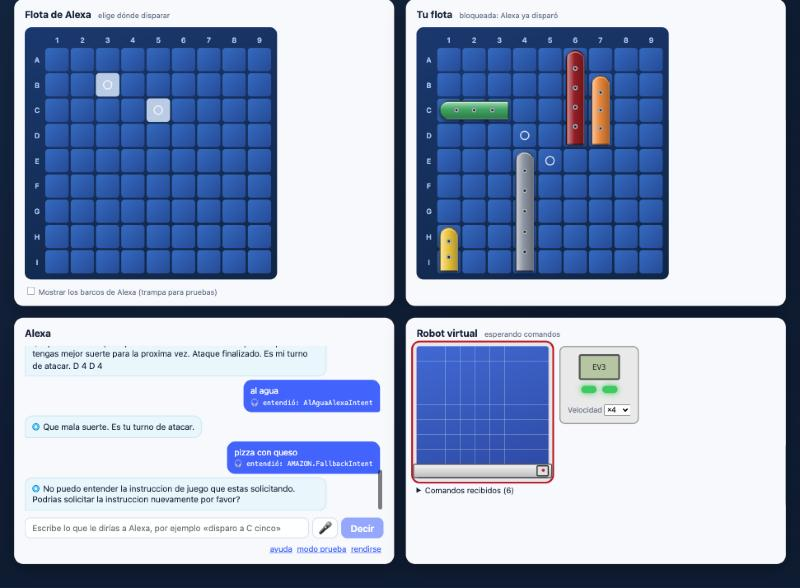
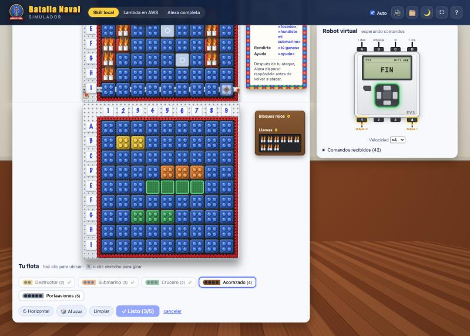
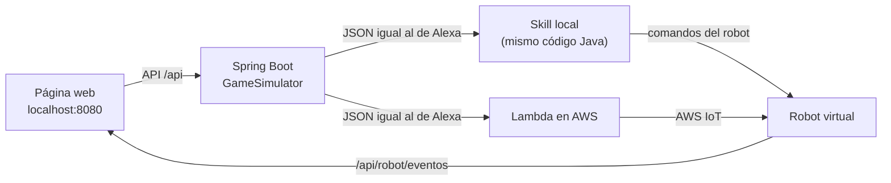

# Simulador web de Batalla Naval

Página web para jugar contra la skill de Alexa **sin el Echo** y, si quieres, **sin el robot**: el simulador hace de robot virtual y muestra en pantalla cada movimiento que haría el EV3. En el modo *Alexa completa* también prueba si Alexa entiende tus frases.


## Cómo iniciarlo

Desde la carpeta del proyecto (`battleship-alexa`):

```bash
./deploy/web.sh
```

Luego abre <http://localhost:8080>.

Requisitos: Java 21 y Maven. Para los modos con AWS necesitas además una sesión de AWS iniciada (`aws login`) y haber ejecutado `./deploy/deploy.sh`, que crea la Lambda y los certificados del robot.

## Modos de juego

| Modo | Contra qué juegas | Qué prueba | El robot virtual recibe los comandos… |
|---|---|---|---|
| **Skill local** | El código Java de la skill, dentro del simulador | La lógica del juego, sin internet | Directamente |
| **Lambda en AWS** | La Lambda real `battleship-alexa:live`, con el mismo JSON que enviaría Alexa | La Lambda desplegada y AWS IoT | Desde **AWS IoT**, si pulsas *conectar* |
| **Alexa completa** | El **simulador oficial de Alexa**: tus frases pasan por su reconocimiento de lenguaje y luego llegan a la Lambda | Además, que Alexa **entienda tus frases** (intents y slots) | Desde **AWS IoT**, si pulsas *conectar* |

En los modos con AWS, *conectar* une el simulador a AWS IoT con los **mismos certificados y el mismo tópico que el EV3** (`battleship/ev3`). El robot virtual recibe exactamente lo que recibiría el robot real, así que puedes probar toda la cadena antes de armar el robot.

> El EV3 y el robot virtual usan el mismo identificador de cliente en AWS IoT, así que no pueden estar conectados a la vez. Si el EV3 está encendido, desconecta el robot virtual.

### Modo «Alexa completa»



En este modo el simulador no arma los intents: envía **lo que dices como texto** al simulador de Alexa (`ask smapi simulate-skill`), igual que si le hablaras a un Echo. Los clics y los botones también se convierten en frases ("C cinco", "tocado", "hundiste mi submarino").

- Escribe cualquier frase en el cuadro *Escribe lo que le dirías a Alexa*. También puedes probar formas distintas de decir lo mismo, por ejemplo "disparo a la fila B columna tres".
- 🎤 **Micrófono:** si tu navegador lo permite (Chrome o Edge), habla y la frase se envía sola.
- Bajo cada mensaje tuyo aparece **lo que entendió Alexa** (🎧), con el intent y los slots, por ejemplo `entendió: AtaqueJugadorIntent · Fila=B Columna=3`. Si una frase cae en `AMAZON.FallbackIntent`, Alexa no la reconoció como una instrucción del juego: es una buena candidata para agregarla como frase de ejemplo en `alexa-skill/Battleship_es.json`.

Requisitos: la ASK CLI configurada (`ask configure`) y la skill habilitada para pruebas (lo hace `deploy/skill.sh`). Cada turno tarda unos 5 segundos, porque pasa por los servidores de Alexa.

## Cómo se juega

1. **Ubica tus barcos** (ver abajo), o deja los que el simulador ubicó al azar.
2. Pulsa **▶ Nueva partida**: el simulador abre la skill ("Alexa, abre batalla naval") y dice "comenzar juego". Luego elige el nivel en la barra superior: **básico**, **medio** o **avanzado**.
3. **Ataca** haciendo clic en una casilla de la *Flota de Alexa*.
4. Alexa contraataca y su disparo parpadea en *Tu flota*. Respóndele con **💧 Al agua**, **💥 Tocado** o **🔥 Hundido** (eligiendo qué barco hundió). Si activas *Respuesta automática*, el simulador responde solo según dónde están tus barcos.

La barra superior siempre indica de quién es el turno y qué hacer.

### Ubicar tus barcos



1. Pulsa **✎ Ubicar mis barcos**.
2. Elige un barco en el astillero (debajo de tu tablero).
3. Mueve el mouse sobre tu tablero: la vista previa se ve **verde** si el barco cabe y **roja** si se sale del tablero o choca con otro.
4. **Gira** el barco con la tecla <kbd>R</kbd>, con el clic derecho o con el botón *↻*.
5. **Haz clic** para dejarlo. El astillero pasa solo al siguiente barco.
6. Para **mover** un barco ya ubicado, haz clic sobre él: se levanta y lo puedes dejar en otro lugar.
7. Cuando estén los 5, pulsa **✓ Listo**.

*🎲 Al azar* ubica los 5 barcos por ti y *Limpiar* los saca todos. Los barcos se pueden mover hasta que Alexa dispare por primera vez; después quedan bloqueados hasta la próxima partida.

### Otras opciones

- **Mostrar los barcos de Alexa:** trampa para pruebas; los marca con un borde amarillo.
- **Voz:** lee las respuestas de Alexa con la voz del navegador.
- **Velocidad del robot:** *real* usa los mismos tiempos que el EV3 (700 ms por casilla); *×4* va 4 veces más rápido.

## Colores y efectos

| En pantalla | Significado |
|---|---|
| Mar azul con olas | Casilla sin atacar |
| Salpicadura blanca | Agua |
| Explosión roja con ✕ | Impacto |
| Rojo oscuro con ✕ / barco gris oscuro | Barco hundido |
| Recuadro amarillo parpadeando | Disparo de Alexa que todavía no respondes |
| Barcos de colores | Tu flota, con los colores Duplo sugeridos: destructor amarillo, submarino naranja, crucero verde, acorazado rojo oscuro y portaaviones gris |

## Cómo funciona



- `GameSimulator` arma los pedidos de Alexa (`LaunchRequest` e `IntentRequest` con sus slots), guarda los atributos de sesión entre turnos y lee la partida (`jsonGame`) para dibujar los tableros.
- `LocalSkillGateway` ejecuta la skill dentro del simulador; `LambdaSkillGateway` invoca la Lambda con tus credenciales de AWS; `AlexaSimulatorGateway` envía frases al simulador de Alexa con la ASK CLI y lee lo que entendió.
- `IotRobot` es el robot virtual en AWS IoT.
- `PlayerFleet` guarda tu flota y valida los barcos que ubicas a mano: que no se salgan del tablero, que no se superpongan y que estén los 5.
- La página (`src/main/resources/static`) está hecha con **Vue 3**, incluido como WebJar en el `pom.xml`, así que funciona sin internet y sin herramientas de build. Consulta los comandos del robot cada 400 ms y los anima en el mismo orden que `motion.py`: fila, columna, empuje y vuelta a la posición inicial.

En los modos *Skill local* y *Lambda en AWS* las instrucciones se envían directamente como *intents*; el reconocimiento de lenguaje solo se prueba en el modo *Alexa completa*.

## Tests

```bash
mvn -f simulador/pom.xml test
```

Son 17 tests. Juegan partidas contra la skill local (incluida una completa hasta que el jugador gana), verifican las respuestas automáticas y los comandos que recibe el robot, y comprueban la validación de la flota: barcos fuera del tablero, superpuestos, incompletos, y el bloqueo después del primer disparo de Alexa. El modo *Alexa completa* se prueba con respuestas reales capturadas del simulador de Alexa (`src/test/resources/alexa-sim`, sin tokens ni identificadores de cuenta), así que los tests no necesitan internet.

## Próximas mejoras

- Jugar en inglés.
- Varias partidas a la vez, una por pestaña.
