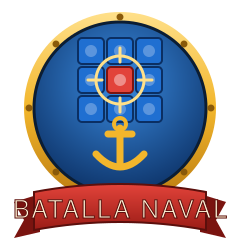
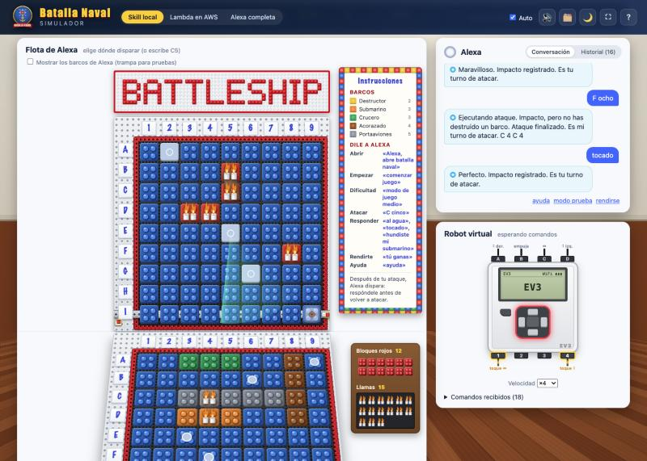
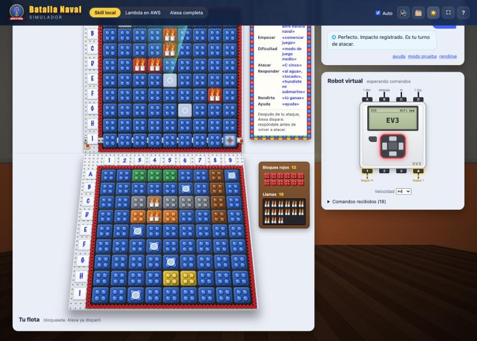
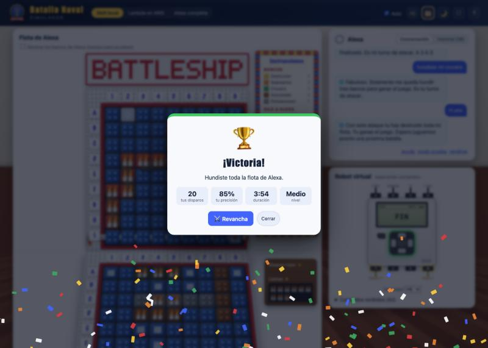
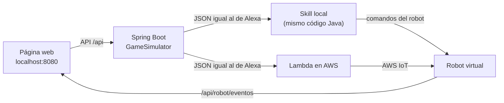

<p align="center"></p>

# Simulador web de Batalla Naval

Página web para jugar contra la skill de Alexa **sin el Echo** y, si quieres, **sin el robot**: el simulador hace de robot virtual y muestra en pantalla cada movimiento que haría el EV3. En el modo *Alexa completa* también prueba si Alexa entiende tus frases.



## Cómo iniciarlo

Desde la carpeta del proyecto (`battleship-alexa`):

```bash
./deploy/web.sh
```

Luego abre <http://localhost:8080>.

Requisitos: Java 21 y Maven. Para los modos con AWS necesitas además una sesión de AWS iniciada (`aws login`) y haber ejecutado `./deploy/deploy.sh`, que crea la Lambda y los certificados del robot.

## Modos de juego

| Modo | Contra qué juegas | Qué prueba | El robot virtual recibe los comandos… |
|---|---|---|---|
| **Skill local** | El código Java de la skill, dentro del simulador | La lógica del juego, sin internet | Directamente |
| **Lambda en AWS** | La Lambda real `battleship-alexa:live`, con el mismo JSON que enviaría Alexa | La Lambda desplegada y AWS IoT | Desde **AWS IoT**, si pulsas *conectar* |
| **Alexa completa** | El **simulador oficial de Alexa**: tus frases pasan por su reconocimiento de lenguaje y luego llegan a la Lambda | Además, que Alexa **entienda tus frases** (intents y slots) | Desde **AWS IoT**, si pulsas *conectar* |

En los modos con AWS, *conectar* une el simulador a AWS IoT con los **mismos certificados y el mismo tópico que el EV3** (`battleship/ev3`). El robot virtual recibe exactamente lo que recibiría el robot real, así que puedes probar toda la cadena antes de armar el robot.

> El EV3 y el robot virtual usan el mismo identificador de cliente en AWS IoT, así que no pueden estar conectados a la vez. Si el EV3 está encendido, desconecta el robot virtual.

### Modo «Alexa completa»


En este modo el simulador no arma los intents: envía **lo que dices como texto** al simulador de Alexa (`ask smapi simulate-skill`), igual que si le hablaras a un Echo. Los clics y los botones también se convierten en frases ("C cinco", "tocado", "hundiste mi submarino").

- Escribe cualquier frase en el cuadro *Escribe lo que le dirías a Alexa*. También puedes probar formas distintas de decir lo mismo, por ejemplo "disparo a la fila B columna tres".
- 🎤 **Micrófono:** si tu navegador lo permite (Chrome o Edge), habla y la frase se envía sola.
- Bajo cada mensaje tuyo aparece **lo que entendió Alexa** (🎧), con el intent y los slots, por ejemplo `entendió: AtaqueJugadorIntent · Fila=B Columna=3`. Si una frase cae en `AMAZON.FallbackIntent`, Alexa no la reconoció como una instrucción del juego: es una buena candidata para agregarla como frase de ejemplo en `alexa-skill/Battleship_es.json`.

Requisitos: la ASK CLI configurada (`ask configure`) y la skill habilitada para pruebas (lo hace `deploy/skill.sh`). Cada turno tarda unos 5 segundos, porque pasa por los servidores de Alexa.

## Cómo se juega

1. **Ubica tus barcos** (ver abajo), o deja los que el simulador ubicó al azar.
2. Pulsa **▶ Nueva partida**: el simulador abre la skill ("Alexa, abre batalla naval") y dice "comenzar juego". Luego elige el nivel en la barra superior: **básico**, **medio** o **avanzado**.
3. **Ataca** haciendo clic en una casilla de la *Flota de Alexa*.
4. Alexa contraataca y su disparo parpadea en *Tu flota*. Respóndele con **💧 Al agua**, **💥 Tocado** o **🔥 Hundido** (eligiendo qué barco hundió). Con el interruptor **Auto** (arriba a la derecha) activado, el simulador responde solo según dónde están tus barcos.

La barra superior siempre indica de quién es el turno y qué hacer.

### Ubicar tus barcos


1. Pulsa **✎ Ubicar mis barcos**.
2. Elige un barco en el astillero (debajo de tu tablero).
3. Mueve el mouse sobre tu tablero: la vista previa se ve **verde** si el barco cabe y **roja** si se sale del tablero o choca con otro.
4. **Gira** el barco con la tecla <kbd>R</kbd>, con el clic derecho o con el botón *↻*.
5. **Haz clic** para dejarlo. El astillero pasa solo al siguiente barco.
6. Para **mover** un barco ya ubicado, haz clic sobre él: se levanta y lo puedes dejar en otro lugar.
7. Cuando estén los 5, pulsa **✓ Listo**.

*🎲 Al azar* ubica los 5 barcos por ti y *Limpiar* los saca todos. Los barcos se pueden mover hasta que Alexa dispare por primera vez; después quedan bloqueados hasta la próxima partida.

### Otras opciones

- **Mostrar los barcos de Alexa:** trampa para pruebas; los marca con un borde amarillo.
- **Velocidad del robot:** *real* usa los mismos tiempos que el EV3 (700 ms por casilla); *×4* va 4 veces más rápido.

## Gráficos, sonido y atajos


### Gráficos
- **Logotipo propio** (`static/img/logo.svg`) y su ícono en la pestaña del navegador.
- **Aspecto del robot real de LEGO:** casillas como bloques Duplo de 2x2, impactos con la pieza de llamas, rótulos en tarjetas blancas escritas en azul, marco de vigas Technic y el cartel "BATTLESHIP".
- **🧱 Vista robot** (por defecto): el tablero de Alexa va de pie, como la pared del robot, y el tuyo acostado delante en perspectiva. Al ubicar tus barcos el tablero se levanta para que sea fácil hacer clic. Con 🗂️ vuelves a la vista clásica, con los tableros lado a lado.
- **El carro del robot:** en la vista robot tu disparo no es un proyectil. La viga gris sube o baja hasta la fila, el motor que empuja avanza hasta la columna (con los mismos tiempos que el robot real y la velocidad ×4 o real del panel del robot), empuja el bloque azul, el bloque salta hacia adelante y aparece el resultado. Alexa contraataca recién cuando el robot termina.
- **Movimiento con la física del robot real:** los tiempos salen de `battleship-ev3/config.py` (140° por fila y 280° por columna a 400°/s, empuje de 350° de ida y vuelta, vuelta a casa al 40 % de velocidad, primero la columna y después la fila). La pared vibra mientras giran los motores, y los dos sensores táctiles (puertos 1 y 4) se sueltan cuando el carro se aleja y hacen clic al presionarse en I9.
- **Ladrillo EV3 dibujado:** pantalla con la casilla que ataca el robot, botones con la luz de estado (verde = listo, naranja parpadeante = moviéndose, rojo = impacto, como en `robot.py`) y los cables a los puertos A, B, C, D, 1 y 4. Cada puerto se enciende mientras gira su motor o mientras su sensor táctil está presionado; pasa el mouse sobre un puerto para ver qué tiene conectado.
- **Tus barcos como bloques Duplo:** en la vista robot cada casilla de tus barcos es un bloque Duplo del color del barco (amarillo, naranja, verde, café y gris), como en el tablero real. Cuando Alexa hunde uno, sus bloques se oscurecen.
- **Cartel de instrucciones:** al lado de la pared de Alexa va un cartel con borde de ladrillos de colores, como el del robot real, con los barcos y las frases para decirle a Alexa. En pantallas angostas aparece arriba del cartel BATTLESHIP. La versión para imprimir está en [`docs/cartel-instrucciones.md`](../docs/cartel-instrucciones.md).
- **La habitación y el plástico:** en la vista robot el mar se cambia por una pared clara y un piso de tablas de madera, como en las fotos del robot (en modo noche, con luz de lámpara). Al empujar un bloque suena el clic de plástico y el bloque que cae y rebota; al ubicar tus barcos suena el clic de un bloque que encaja.
- **Bandeja de piezas:** al lado de tu tablero hay 17 bloques rojos y 17 llamas, una por cada casilla de barco. Cada impacto tuyo en la pared de Alexa gasta un bloque rojo y cada impacto de Alexa en tu tablero gasta una llama, justo cuando aparece el resultado. En pantallas angostas la bandeja va debajo del tablero.
- **Fondo animado:** cielo, sol, olas en capas y una rosa de los vientos. Con 🌙 cambia a **modo noche**, con luna y estrellas.
- **Cada disparo:** un proyectil vuela en arco hasta la casilla. Si es **agua**, salta una columna de agua con gotas; si es **impacto**, hay una explosión con chispas y **humo que queda** sobre la casilla. Cuando un barco se **hunde**, se inclina, se oscurece y suben burbujas.
- **Radar:** mientras eliges dónde disparar, un barrido verde recorre la flota de Alexa.
- **Restos:** los barcos de Alexa que hundes aparecen en su tablero.
- **Marcador:** las siluetas de ambas flotas (se tachan al hundirse), los disparos, la precisión de cada uno y el tiempo de la partida.
- **Anillo de Alexa:** gira cuando Alexa piensa, pulsa cuando escucha (modo *Alexa completa*) y brilla cuando habla.
- **Pantalla final:** victoria con confeti y fanfarria, o derrota con tambores, más las estadísticas y el botón **⚔️ Revancha**.

| Modo noche | Victoria |
|---|---|
|  |  |

### Sonido 🔊
Todos los sonidos se generan en el navegador (Web Audio), sin archivos de audio:
- cañonazo y silbido del proyectil, salpicadura, explosión y sirena cuando hunden un barco;
- fanfarria de victoria y tambores de derrota;
- zumbido de los motores del robot virtual y el "clic" del sensor al volver a la posición inicial;
- **mar de fondo** opcional (olas y gaviotas).

En el menú 🔊 se ajustan el **volumen**, **silenciar todo**, el **mar de fondo** y la **voz de Alexa**. La voz se elige sola entre las voces en español del sistema (prefiere es-US y es-MX) y lee cada respuesta de Alexa. Las preferencias se guardan en el navegador.

### Atajos de teclado

| Tecla | Acción |
|---|---|
| Letra de la fila + número (por ejemplo <kbd>C</kbd> <kbd>5</kbd>) | Disparar a esa casilla |
| <kbd>A</kbd> / <kbd>T</kbd> / <kbd>H</kbd> | Responder a Alexa: agua, tocado o hundido (con *Auto* desactivado) |
| <kbd>R</kbd> | Girar el barco mientras lo ubicas |
| <kbd>?</kbd> | Ver el tutorial |
| <kbd>Esc</kbd> | Cancelar la casilla escrita o cerrar ventanas |

### Más opciones
- **Tutorial:** se muestra solo la primera vez (6 pasos). Para verlo de nuevo, pulsa **?**.
- **Historial:** la pestaña *Historial* lista cada disparo con su resultado, la hora y, en el modo *Alexa completa*, lo que entendió Alexa.
- **⛶ Pantalla completa** y diseño adaptado a tablet.

## Colores y efectos

| En pantalla | Significado |
|---|---|
| Bloque Duplo azul | Casilla sin atacar |
| Bloque celeste con un círculo | Agua |
| Bloque rojo con la pieza de llamas | Impacto |
| Bloque rojo oscuro con llamas / barco oscurecido | Barco hundido |
| Recuadro amarillo parpadeando | Disparo de Alexa que todavía no respondes |
| Barcos de colores | Tu flota, con los colores Duplo sugeridos: destructor amarillo, submarino naranja, crucero verde, acorazado café y portaaviones gris |

## Cómo funciona



- `GameSimulator` arma los pedidos de Alexa (`LaunchRequest` e `IntentRequest` con sus slots), guarda los atributos de sesión entre turnos y lee la partida (`jsonGame`) para dibujar los tableros.
- `LocalSkillGateway` ejecuta la skill dentro del simulador; `LambdaSkillGateway` invoca la Lambda con tus credenciales de AWS; `AlexaSimulatorGateway` envía frases al simulador de Alexa con la ASK CLI y lee lo que entendió.
- `IotRobot` es el robot virtual en AWS IoT.
- `PlayerFleet` guarda tu flota y valida los barcos que ubicas a mano: que no se salgan del tablero, que no se superpongan y que estén los 5.
- La página (`src/main/resources/static`) está hecha con **Vue 3**; los sonidos están en `js/sound.js` y los efectos visuales en `js/effects.js` (Web Animations API), ambos sin librerías externas, incluido como WebJar en el `pom.xml`, así que funciona sin internet y sin herramientas de build. Consulta los comandos del robot cada 400 ms y los anima en el mismo orden que `motion.py`: fila, columna, empuje y vuelta a la posición inicial.

En los modos *Skill local* y *Lambda en AWS* las instrucciones se envían directamente como *intents*; el reconocimiento de lenguaje solo se prueba en el modo *Alexa completa*.

## Tests

```bash
mvn -f simulador/pom.xml test
```

Son 17 tests. Juegan partidas contra la skill local (incluida una completa hasta que el jugador gana), verifican las respuestas automáticas y los comandos que recibe el robot, y comprueban la validación de la flota: barcos fuera del tablero, superpuestos, incompletos, y el bloqueo después del primer disparo de Alexa. El modo *Alexa completa* se prueba con respuestas reales capturadas del simulador de Alexa (`src/test/resources/alexa-sim`, sin tokens ni identificadores de cuenta), así que los tests no necesitan internet.

## Próximas mejoras

- Jugar en inglés.
- Varias partidas a la vez, una por pestaña.
