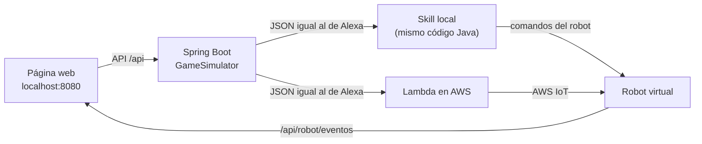

# Simulador web de Batalla Naval

Página web para jugar contra la skill de Alexa **sin el Echo** y, si quieres, **sin el robot**: el simulador hace de robot virtual y muestra en pantalla cada movimiento que haría el EV3.


## Cómo iniciarlo

Desde la carpeta del proyecto (`battleship-alexa`):

```bash
./deploy/web.sh
```

Luego abre <http://localhost:8080>.

Requisitos: Java 21 y Maven. Para los modos con AWS necesitas además una sesión de AWS iniciada (`aws login`) y haber ejecutado `./deploy/deploy.sh`, que crea la Lambda y los certificados del robot.

## Modos de juego

| Modo | Contra qué juegas | El robot virtual recibe los comandos… |
|---|---|---|
| **Skill local (sin AWS)** | El código Java de la skill, ejecutándose dentro del simulador | Directamente, sin internet |
| **Lambda en AWS** | La Lambda real `battleship-alexa:live`, con el mismo JSON que enviaría Alexa | Desde **AWS IoT**, si pulsas *Conectar como robot* |

En el modo **Lambda en AWS**, *Conectar como robot* conecta el simulador a AWS IoT con los **mismos certificados y el mismo tópico que el EV3** (`battleship/ev3`). El robot virtual recibe exactamente lo que recibiría el robot real, así que puedes probar toda la cadena (Lambda → AWS IoT → robot) antes de armar el robot.

> El EV3 y el robot virtual usan el mismo identificador de cliente en AWS IoT, así que no pueden estar conectados a la vez. Si el EV3 está encendido, desconecta el robot virtual.

## Cómo se juega

1. **Alexa, abre batalla naval**, luego **Comenzar juego** y elige el nivel.
2. **Ataca** haciendo clic en una casilla del *Tablero de Alexa*.
3. Alexa contraataca. Su disparo parpadea en amarillo en *Tu tablero*.
4. Respóndele con **Al agua**, **Tocado** o **Hundido** (puedes elegir qué barco hundió). Si marcas *Responder a Alexa automáticamente*, el simulador responde solo según dónde están tus barcos.

Otras opciones:
- **Ubicar mis barcos al azar:** cambia la posición de tu flota (los barcos en amarillo).
- **Mostrar los barcos de Alexa:** trampa para pruebas; los marca con un borde amarillo.
- **Voz de Alexa:** lee las respuestas con la voz del navegador.
- **Velocidad del robot:** *real* usa los mismos tiempos que el EV3 (700 ms por casilla); *rápida* va 4 veces más rápido.

## Colores

| Color | Significado |
|---|---|
| Azul | Casilla sin atacar (mar) |
| Gris con punto | Agua |
| Rojo con ✕ | Impacto |
| Rojo oscuro con ✕ | Barco hundido (en tu tablero) |
| Amarillo | Tus barcos |
| Amarillo parpadeando | Disparo de Alexa que todavía no respondes |

## Cómo funciona



- `GameSimulator` arma los pedidos de Alexa (`LaunchRequest` e `IntentRequest` con sus slots), guarda los atributos de sesión entre turnos y lee la partida (`jsonGame`) para dibujar los tableros.
- `LocalSkillGateway` ejecuta la skill dentro del simulador; `LambdaSkillGateway` invoca la Lambda con tus credenciales de AWS.
- `IotRobot` es el robot virtual en AWS IoT.
- La página (`src/main/resources/static`) consulta los comandos del robot cada 400 ms y los anima en el mismo orden que `motion.py`: fila, columna, empuje y vuelta a la posición inicial.

Las respuestas de Alexa se envían directamente como *intents*. Este simulador no prueba el reconocimiento de voz; para eso está `deploy/simulate.py`, que usa el simulador oficial de Alexa.

## Tests

```bash
mvn -f simulador/pom.xml test
```

Juegan partidas contra la skill local, incluida una completa hasta que el jugador gana, y verifican las respuestas automáticas y los comandos que recibe el robot.

## Próximas mejoras

- Ubicar los barcos a mano, con clics.
- Modo "Alexa completa", usando el simulador oficial de Alexa para probar también el reconocimiento de frases.
- Jugar en inglés.
- Varias partidas a la vez, una por pestaña.
